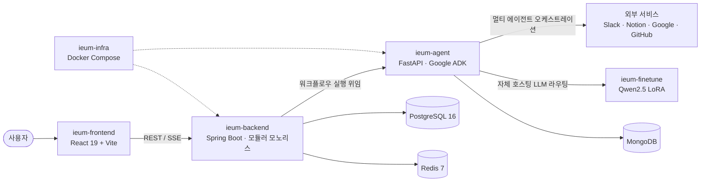

<p align="center">
  
</p>

<h1 align="center">IEUM &nbsp;이음</h1>

<p align="center"><b>AI 에이전트 기반 업무 자동화 플랫폼</b><br/>Zapier/Make의 워크플로우 자동화에 AI Agent를 결합한 B2B/B2G 솔루션</p>

<p align="center">
  
</p>

자연어로 워크플로우를 **생성·수정·실행**하고, AI 에이전트가 다양한 외부 서비스(Slack, Notion, Google, GitHub 등)를 오케스트레이션하여 업무를 자동화합니다.

<p align="center">


</p>

### 🎬 서비스 시연 영상

[](https://youtu.be/0g8YClOgHyw)

> 위 썸네일을 클릭하면 YouTube 시연 영상으로 이동합니다.

---

## 🧩 시스템 구성

IEUM은 역할별로 분리된 여러 레포지토리로 구성된 조직 프로젝트입니다.



---

## 📦 레포지토리 구성

| 레포 | 역할 | 핵심 스택 |
|------|------|-----------|
| [`ieum-frontend`](./ieum-frontend) | 워크플로우 빌더 UI · 대시보드 | React 19, TypeScript 5, Vite 7, Zustand, React Query, Tailwind 4 |
| [`ieum-backend`](./ieum-backend) | REST API · 인증 · 워크플로우 엔진 · 크레덴셜 관리 | Java 21, Spring Boot 3.5, Gradle 멀티모듈, PostgreSQL 16, Redis 7 |
| [`ieum-agent`](./ieum-agent) | AI 노드 실행 · 동적 워크플로우 생성/수정 · 멀티 에이전트 | Python 3.11+, FastAPI, Google ADK, MongoDB |
| [`ieum-finetune`](./ieum-finetune) | 워크플로우 생성/수정용 자체 LLM 파인튜닝 파이프라인 | Qwen2.5-7B, QLoRA(Unsloth), vLLM |
| [`ieum-infra`](./ieum-infra) | 로컬/배포 인프라 (Docker Compose) | Docker Compose |
| [`ieum-presentation`](./ieum-presentation) | 프로토타입 발표 자료 | HTML 슬라이드 덱 |

---

## ✨ 핵심 기능

- **자연어 워크플로우 생성** — 요청을 입력하면 Reflexion 검증 루프를 거쳐 스키마에 안전한 워크플로우 JSON을 생성
- **대화형 수정·실행** — 채팅으로 워크플로우를 수정하고 실행 결과를 받음
- **멀티 에이전트 오케스트레이션** — Main Orchestrator가 Web/Comm/Transform/GitHub/Notion/Google 등 서브 에이전트에 작업 위임
- **멀티 LLM 지원** — Gemini · OpenAI · Claude, 그리고 자체 호스팅 파인튜닝 모델 라우팅
- **BYOK 크레덴셜 관리** — 사용자별 AI API Key 및 프로바이더 관리 (AES-256 암호화)
- **인증/인가** — JWT + Google OAuth2

---

## 🏗️ 백엔드 모듈 구조

`ieum-backend`는 단방향 의존(순환 참조 금지)을 강제하는 모듈러 모노리스입니다.

```
api → workflow-core, auth
workflow-core → integration, ai
integration → auth
모든 모듈 → common
```

| 모듈 | 역할 |
|------|------|
| `api` | REST API 진입점 (유일한 Spring Boot 실행 모듈) |
| `auth` | 인증/인가 (JWT + OAuth2) |
| `workflow-core` | 워크플로우 엔진 (핵심 비즈니스) |
| `ai` | AI 프로바이더 연동 + 크레덴셜 BYOK |
| `integration` | 외부 서비스 커넥터 (Google, Notion 등) |
| `common` | 공통 예외, DTO, BaseEntity, 유틸 |

---

## 🚀 빠른 시작

각 레포의 README를 참고하세요. 인프라는 `ieum-infra`의 Docker Compose로 의존 서비스(PostgreSQL, Redis, MongoDB)를 띄울 수 있습니다.

```bash
# 1. 인프라 (DB, 캐시 등)
cd ieum-infra/compose && docker compose up -d

# 2. 백엔드
cd ieum-backend && ./gradlew :api:bootRun

# 3. AI 에이전트
cd ieum-agent && uvicorn app.main:app --reload

# 4. 프론트엔드
cd ieum-frontend && npm install && npm run dev
```

> 각 서비스의 환경변수(`.env`) 설정은 해당 레포 README를 확인하세요.

---

## 📂 디렉터리 구조

```
IEUMWorkSpace/
├── ieum-frontend/      # 웹 클라이언트 (React)
├── ieum-backend/       # API 서버 (Spring Boot)
├── ieum-agent/         # AI 에이전트 서버 (FastAPI)
├── ieum-finetune/      # 자체 LLM 파인튜닝
├── ieum-infra/         # 인프라 (Docker Compose)
└── ieum-presentation/  # 발표 자료
```
